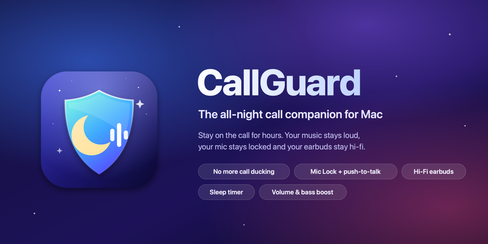
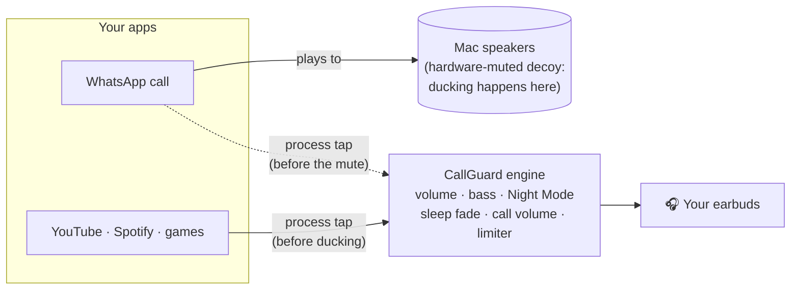

<p align="center">
  
</p>

<p align="center">
  
  
  
  
  
</p>

<h3 align="center">Fall asleep on a call. Wake up with your mic still muted and your music still loud.</h3>

**CallGuard is a free, open-source macOS menu bar app that stops your Mac lowering music and video volume during
calls, locks your microphone so nobody can hear you, keeps Bluetooth earbuds out of muffled call mode, and adds
studio-quality bass, 8D audio and slowed + reverb effects to any app.** It works with WhatsApp, and is built on
Apple's public Core Audio APIs with no drivers. Runs on macOS 14.4 or later (Apple silicon and Intel).

<sub>Latest version: 3.3 · last updated 16 November 2026</sub>

<p align="center">
  CallGuard is a free menu bar app for people who stay on calls for hours (long-distance couples, study calls,
  late-night gaming, all-night "sleep calls"). It fixes the three things macOS gets wrong on long calls,
  then adds the tools you wish you had at 2 a.m.
</p>

---

## The three problems

| What happens | Why | What CallGuard does |
|---|---|---|
| 🎧 You roll over, your earbud registers a tap, and **you're unmuted** on the call. | The earbud tap toggles the call app's own mute button. | **Mic Lock** mutes the microphone at the hardware level. Whatever the app's button says, it gets digital silence. Anything that un-mutes the mic is reversed within milliseconds. |
| 🔉 The moment a call starts, **YouTube and Spotify drop to a whisper.** | The call engine macOS gives call apps "ducks" all other sound on the device it plays to. Only the call app can change how much; there is no switch for you. | **No Ducking** moves the call app to a silent decoy device, where the ducking happens harmlessly, and plays everything to your earbuds from a copy taken before ducking. |
| 🫥 Your music suddenly sounds **muffled, like a phone line.** | When a call app uses the earbud mic, Bluetooth drops the earbuds into a low-quality headset mode (16 kHz, mono). | **Hi-Fi Buds** makes calls use the Mac's microphone, so your earbuds stay in stereo hi-fi. |

## Everything in one glass panel

<p align="center">
  <picture>
    <source media="(prefers-color-scheme: dark)" srcset="assets/panel-dark.png">
    
  </picture>
</p>

### Features

**For the call**
- **Mic Lock**: hardware-level mute for every microphone, including ones that connect later (AirPods, USB headsets). A red **LOCKED** sign sits in the menu bar so you always know.
- **One-click unmute**: click the red **LOCKED** icon (or the **Unmute me** button) and you're live straight away.
- **Push-to-talk while locked**: hold **⌃⌥T** to speak, let go and you're muted again. **⌃⌥M** locks and unlocks from anywhere. No Accessibility permission needed.
- **Blocked-unmute counter**: see how many times an earbud tap or an app tried to un-mute you overnight.
- **No Ducking**: media stays at full volume during calls (details in [How it works](#how-it-works)).
- **Call voice volume**: turn the other person up or down without touching your music.
- **Hi-Fi Buds**: stops Bluetooth earbuds from dropping into muffled headset mode.

**For falling asleep**
- **Sleep timer**: music and videos fade out gently after 15 min to 2 h, **and the call voice stays**.
- **Lock mic when I go quiet**: if you stop touching the keyboard and trackpad for 5–60 minutes during a call, CallGuard locks your mic for you.
- **Unlock when the call ends**, so your mic isn't left muted the next day.
- **Night Mode**: evens out sudden loud bits (ads, explosions, a laugh track) so they don't wake you.

**For your ears**
- **Studio Master** ✨: a mastering-style "premium sound" switch with one Intensity control. Harmonic bass lets small
  earbuds and laptop speakers *sound* deep (your ear fills in the low note), the bass is tightened and centred, boxiness
  is dipped, and vocals get presence and the highs get air.
- **Effects** with one-tap presets: **Slowed + Reverb**, **Sped Up**, **Ambience**, **Harmony** and **Dreamy**, plus
  sliders for pitch, reverb, room size, harmony and stereo width.
- **8D Audio** 🎧: the music slowly circles your head (front, right, behind, left), with its own on/off switch and speed.
- **Volume boost to 300%** and **bass boost to +12 dB** for all Mac audio, with a limiter that never lets it clip.
- All of it applies to **music and videos only**. The other person's voice on a call is never changed.
- **Live level meters**, a **call timer** and an **activity log** of everything CallGuard did.

**Under the hood**
- Native SwiftUI with **Liquid Glass** on macOS 26 and later (and a matching material look on macOS 14–15). Light and dark mode.
- **No drivers, no kernel extensions, no virtual audio cable.** Built on Apple's public Core Audio process-tap API.
- **0.0% CPU when idle**, about 0.6% of one core while processing audio. Universal binary.
- **Private**: no network access, no analytics, nothing recorded or saved.

## How it works



1. When a call starts, CallGuard points the system output (and with it the call app) at the Mac's built-in speakers, which it **mutes at the hardware level**. The call app's ducking now lands on a device nobody is listening to.
2. **Core Audio process taps** collect every app's sound *before* it is ducked or muted, in two separate streams: media and call voice.
3. CallGuard mixes them, applies your settings, and plays the result on your earbuds through a **private aggregate device**.
4. Your **volume keys keep working**: CallGuard copies them to your earbuds. When the call ends, everything goes back exactly as it was.
5. If a call app refuses to move, CallGuard puts things back within 4 seconds and makes up for the ducking with extra gain instead.

**Measured on a MacBook Air (Apple silicon, macOS 27)**

| Check | Result |
|---|---|
| Mic Lock: what an app records while locked | exact digital silence (0 non-zero samples) |
| Input volume 0 instead of mute (what most "mute" apps do) | still −64 dBFS of room sound, which is why CallGuard uses hardware mute |
| An outside "unmute" while locked | re-muted within milliseconds, and counted |
| Ducking from the call engine, default vs. minimum setting | 19 dB difference, out of the user's control |
| No Ducking during a real WhatsApp call | media at full level ("like I'm not on a call") |
| Volume 200% | +6.0 dB |
| Bass +12 dB at 50–60 Hz | +11 dB on the low notes, 3 kHz untouched |
| Limiter: a −6 dBFS signal at 300% | held at −1.0 dBFS, no clipping |
| Night Mode | a 34 dB loud-to-quiet jump squeezed to 17 dB |
| Sleep fade | media silent, call voice unchanged |
| Studio Master harmonic bass (50 Hz note) | adds its 100 Hz overtone 36 dB above the plain signal; the note itself is kept |
| Studio Master tone shaping | −2.5 dB at 320 Hz, +3.3 dB at 14 kHz, 1 kHz vocals within 0.2 dB |
| Slowed −3 / Sped up +3 | the note lands exactly 3 semitones lower or higher |
| 8D Audio | fully right at ¼ turn, centred behind at ½, fully left at ¾; call voice stays centred |
| Everything maxed at once (Studio, effects, 8D, 300%, +12 dB bass) | held at −1.0 dBFS, no clipping |
| CPU | 0.0% idle, ~0.6% of one core while running |

The full write-up, including how to repeat these measurements yourself, is in [docs/how-it-works.md](docs/how-it-works.md).

## Install

**Download:** grab `CallGuard.zip` from [Releases](../../releases/latest), unzip it and drag **CallGuard** into **Applications**.

CallGuard isn't notarized by Apple yet, so the first launch needs one extra step:
1. Double-click CallGuard, then close the warning.
2. Open **System Settings → Privacy & Security**, scroll down and click **Open Anyway** next to CallGuard.

**Build from source** (needs Xcode 26 or later):

```bash
git clone https://github.com/notshevvv/CallGuard.git
```

```bash
cd CallGuard && ./build.sh && open dist/CallGuard.app
```

### Permissions

| Permission | When | Why |
|---|---|---|
| **Screen & System Audio Recording** (system audio only) | The first time No Ducking, the boost or the sleep timer runs | To take each app's sound before macOS ducks it. Nothing is recorded or stored. |
| None for Mic Lock | | Muting a device needs no permission. |
| None for the shortcuts | | Carbon hot keys don't need Accessibility access. |

Tick **Start at login** in the panel so CallGuard is always there when a call starts.

## Using it

| Control | What it does |
|---|---|
| Click the menu bar mic | Opens the panel. Click anywhere else or press Esc to close it. |
| Click the red **LOCKED** icon | **Unmutes you instantly** (right-click still opens the panel). |
| **Mic Lock** tile or **⌃⌥M** | Lock or unlock every microphone. |
| Hold **⌃⌥T** | Talk while locked (the icon turns green and says **LIVE**). |
| **No Ducking** tile | Keep media at full volume during calls (needs earbuds or headphones). |
| **Hi-Fi Buds** tile | Keep Bluetooth earbuds in stereo by using the Mac's mic for calls. |
| Studio Master | Premium sound. Intensity: Subtle, Rich or Max. |
| Sound boost | Volume, bass, call voice volume, Night Mode and live meters. |
| Effects | Tap a preset, then fine-tune pitch, reverb, room, harmony and width. |
| 8D Audio | Switch on, pick a speed, wear earphones. |
| Falling asleep on a call | Sleep timer, auto-lock when you go quiet, unlock when the call ends. |
| Quit | Gives every mic back and restores your audio setup. |

## Questions people ask

### How do I stop my Mac lowering the volume of music and videos during calls?
macOS turns other audio down ("ducks" it) whenever a call app runs its voice processing, and there is no setting
to switch it off. CallGuard's **No Ducking** fixes it: during a call it points the call app at the Mac's speakers,
muted in hardware, and plays everything to your earbuds from a copy taken before the volume drop.

### Why does my music sound muffled on calls with Bluetooth earbuds or AirPods on a Mac?
When a call app uses the earbuds' microphone, Bluetooth switches them into headset mode, which is 16 kHz mono and
sounds like an old phone line. CallGuard's **Hi-Fi Buds** makes calls use the Mac's built-in mic instead, so the
earbuds stay in stereo (44.1–48 kHz) high quality.

### How do I stop my earbuds or AirPods unmuting me on a WhatsApp call?
Tapping an earbud can toggle the call app's mute button, for example while you sleep. CallGuard's **Mic Lock**
mutes every microphone at the hardware level, so apps receive digital silence whatever their own button says. It
re-mutes within milliseconds if anything unmutes it. Click the red LOCKED icon to talk again.

### Can a Mac app block the microphone for just one app?
No. macOS doesn't let one app block another app's microphone without resetting privacy permissions. Mic Lock
mutes the microphones themselves, so while it's on no app can hear you. Push-to-talk (hold ⌃⌥T) and the one-click
unmute let you speak when you need to.

### How do I get 8D audio on a Mac for any song?
Turn on CallGuard's **8D Audio** and wear earphones. It makes any app's sound, such as Spotify, YouTube or Apple
Music, circle your head, using equal-power panning, a small delay between the ears and head-shadow filtering.
A Speed slider sets one turn every 5–18 seconds.

### How do I play Spotify or YouTube slowed + reverb on a Mac?
Choose the **Slowed + Reverb** preset in CallGuard's Effects. It lowers the pitch by 3 semitones and adds a
large reverb to all system audio live. Live audio can't play slower without falling behind, so the timing stays
in sync with the video while it sounds slowed.

### Is there a free bass booster and volume booster for Mac?
Yes. CallGuard boosts all Mac audio up to 300% and bass up to +12 dB, with a limiter that holds peaks at −1 dBFS
so it never clips. **Studio Master** adds harmonic bass, so small earbuds and laptop speakers can *sound* deep,
plus clearer vocals and airy highs. It's free under the MIT license.

### Which call apps work with No Ducking?
Verified with **WhatsApp** for Mac. It should work with any app that follows the system output device
(FaceTime, Zoom, Teams, Google Meet in a browser, Discord, Telegram…), but these haven't been tested yet. If an
app doesn't move, CallGuard falls back to extra gain automatically. Please
[report what you find](../../issues/new?template=call-app-report.md).

### Why does my Sound menu say "MacBook Speakers" during a call?
That's the decoy. The speakers are hardware-muted and your audio is on your earbuds. Volume keys still control the
earbuds, and the output switches back on its own when the call ends.

### Does No Ducking work on the Mac's own speakers?
No, because the speakers *are* the decoy. Use earbuds, headphones or another output. On the speakers, CallGuard
uses the extra-gain fallback instead.

### What happens if CallGuard crashes during a call?
The decoy speakers stay muted, so you get silence rather than a loud laptop in the night. Reopen CallGuard and it
restores everything. Since 3.1 it also only uses the decoy after it has heard real audio, and a silence guard hands
the call back to your earbuds if capture ever stops.

### Does CallGuard record my audio or send data anywhere?
No. CallGuard has no network code and no analytics. Audio stays in memory for a few milliseconds while it is
processed, then goes straight to your output. Nothing is recorded or saved.

### Is there an iPhone or Windows version?
No iPhone version: iOS doesn't let apps mute other apps' mics or process other apps' sound. On Windows, most of
this is built in. See **[WINDOWS.md](WINDOWS.md)**, which includes one-click registry files to turn call ducking off.

## On Windows?

CallGuard is Mac-only, but Windows can do most of this with built-in settings: see **[WINDOWS.md](WINDOWS.md)**, which includes one-click registry files to turn call ducking off.

## Similar projects

- [Unduck Pro](https://github.com/MrRockySL/Unduck-Pro): keeps media loud on calls, with a per-app volume mixer.
- [Background Music](https://github.com/kyleneideck/BackgroundMusic): per-app volume and auto-pause (uses a virtual driver).
- [eqMac](https://github.com/bitgapp/eqMac): system-wide equalizer.

CallGuard focuses on long calls: the mic safety, sleep and earbud features above.

## Contributing

Bug reports, call-app test results and pull requests are welcome. The code is small and commented:

| File | What's in it |
|---|---|
| `Engine.swift` | Process taps, aggregate device, the real-time DSP (two buses, bass, Night Mode, fade, limiter) |
| `Decoy.swift` | The No Ducking decoy: muted speakers, volume-key mirroring, crash recovery |
| `StudioMaster.swift` | The premium-sound chain (harmonic bass, mono low end, de-mud, presence, air, exciter) |
| `Effects.swift` | Pitch shifter, Freeverb reverb, harmony layer, stereo width |
| `EightD.swift` | 8D rotation: equal-power panning, interaural delay, head shadow, rear cues |
| `MicLock.swift` | Hardware mute, re-mute listeners, push-to-talk, Hi-Fi Buds |
| `CallMonitor.swift` | Call detection, idle time, global shortcuts |
| `PanelView.swift`, `StatusController.swift` | The Liquid Glass panel and menu bar icon |
| `SelfTest.swift` | `--selftest-dsp` offline checks and the live test harness |

Run the offline checks with `.build/release/CallGuard --selftest-dsp`. The `tools/` folder has small command-line tools for measuring audio devices.

## License

[MIT](LICENSE). Free to use, change and share.
