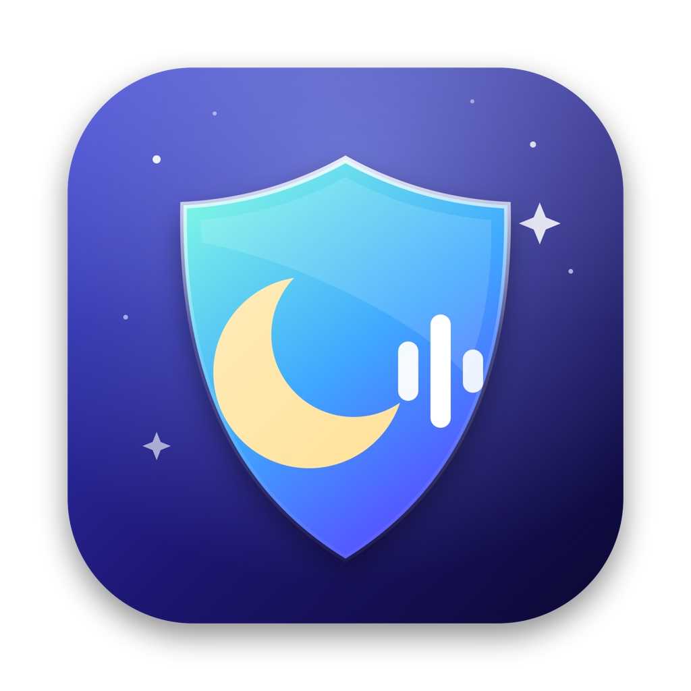

<h1 align="center">The CallGuard fixes on Windows</h1>

CallGuard is a Mac app, but Windows can do most of the same things with settings it already has. 
This page shows how, step by step. No downloads needed.

---

## 1. Stop Windows lowering your music during calls

Windows calls this **communications ducking**. By default it turns other sounds down by 80% whenever it thinks you're on a call.

**The quick way:** download [`windows/stop-call-ducking.reg`](windows/stop-call-ducking.reg), double-click it, click **Yes**, then sign out and back in (or restart).

**By hand:**
1. Press **Win + R**, type `mmsys.cpl` and press Enter.
2. Open the **Communications** tab.
3. Choose **Do nothing** and click **OK**.

Both do the same thing: they set `UserDuckingPreference` to `3` ("Do nothing") under
`HKEY_CURRENT_USER\Software\Microsoft\Multimedia\Audio`.
To undo it, run [`windows/restore-call-ducking.reg`](windows/restore-call-ducking.reg), which puts Windows back to its default.

> Some call apps also have their own ducking setting. In Microsoft Teams, Discord and others, look for "attenuation" or "ducking" in the app's voice settings and turn it off too.

## 2. Stop Bluetooth earbuds sounding muffled on calls

When a call app uses your earbuds' microphone, Bluetooth switches them to a low-quality "hands-free" mode. Everything sounds like an old phone line.

**Best fix (keeps everything working):** let the call use your laptop's microphone instead.
1. **Settings → System → Sound.**
2. Under **Output**, pick your earbuds' **Headphones** entry (stereo), not the one called **Headset** or **Hands-Free**.
3. Under **Input**, pick your laptop's **Microphone Array**.
4. In the call app's settings, choose the same devices.

**Stronger fix:** turn off the earbuds' hands-free mode completely. Your earbuds' own mic will then stop working on Windows.
1. Open **Control Panel → Hardware and Sound → Devices and Printers**.
2. Right-click your earbuds → **Properties** → **Services**.
3. Untick **Hands-free Telephony** and click **OK**.

> Newer earbuds with **Bluetooth LE Audio** on a recent Windows 11 PC can keep stereo sound while using their mic. Check your earbuds' specs.

## 3. Lock your mic so nothing can un-mute you

Windows *can* block the microphone for just one app, which a Mac can't do.

1. **Settings → Privacy & security → Microphone.**
2. Find your call app (for example **WhatsApp**) and switch it **off**.
3. To talk again, switch it back on.

Classic desktop apps are controlled together under **Let desktop apps access your microphone**. To block every mic at once, switch off **Microphone access** at the top of the same page.

## 4. Boost volume and bass

**Built in:** Windows **Loudness Equalization** evens out and raises quiet sound.
1. **Settings → System → Sound →** your output device **→ Properties**.
2. Look for **Audio enhancements** or **Advanced → Enhancements** (the wording depends on your sound driver).
3. Turn on **Loudness Equalization**.

**More control (free and open source):** [Equalizer APO](https://sourceforge.net/projects/equalizerapo/) with the [Peace](https://sourceforge.net/projects/peace-equalizer-apo-extension/) interface gives you a preamp (volume above 100%) and a full bass equalizer for all sound.

## 5. Sleep timer and Night Mode

Windows has no built-in equivalent. Loudness Equalization (above) works as a simple Night Mode, because it keeps sudden loud sounds in check.

---

Found a better way, or does a step look different on your PC? <a href="../../issues">Open an issue</a> and we'll update this page.

